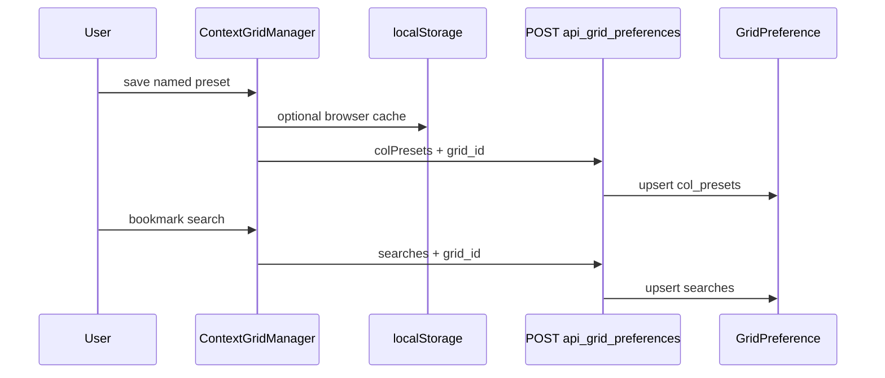

# Saved preferences

Named view presets and saved quick-search bookmarks are user-managed data for
AG-Grid pages. They are separate from browser-local persistent
[page state](page-state.md).



## GridPreference model

| Field | Type | Constraint |
|-------|------|------------|
| `user` | FK → `AUTH_USER_MODEL` | Owner |
| `grid_id` | `CharField(100)` | Matches `scripts.html` `grid_id` and `context.gridId` |
| `col_presets` | JSON object | `{ "Preset name": [ colState, … ] }` or `{ "Preset name": { "columns": [ colState, … ], "pageState": { … } } }` |
| `searches` | JSON list of strings | Quick-search bookmarks |

Unique: `(user, grid_id)`.

## Host setup

```bash
python manage.py migrate grid_view_spec_django
```

```python
from grid_view_spec.backends.django.views import save_grid_prefs

urlpatterns = [
    path("api/grid/preferences/", save_grid_prefs, name="api_grid_preferences"),
]
```

URL name **`api_grid_preferences`** is required — `scripts.html` resolves it with ``.

View context for initial load:

```python
return render(request, "page.html", {
    "ag_grid_presets": json.dumps(presets),   # "{}" or preset dict
    "ag_grid_searches": json.dumps(searches), # "[]" or string list
})
```

## Save API contract

| | |
|---|---|
| Method | `POST` |
| URL | Host-defined; name must be `api_grid_preferences` |
| Auth | Authenticated users persist to `GridPreference`; anonymous requests are local-only |
| Content-Type | `application/json` |

### Request body

```json
{
  "grid_id": "products",
  "colPresets": {
    "Finance view": [{ "colId": "name", "hide": false, "width": 220 }]
  },
  "searches": ["north region", "priority"]
}
```

| Field | Required | Semantics |
|-------|----------|-----------|
| `grid_id` | yes | Target grid |
| `colPresets` | no | Full replacement of named presets when present |
| `searches` | no | Full replacement of search list when present |

`colPresets` values are AG Grid `getColumnState()` arrays for column-only views. A
host can register `PageStateHooks` on the column-settings handle. A newly saved
preset then stores an envelope with columns and host-owned `pageState`. This payload
belongs to the named preset and is applied only when that preset is selected. It is
not `GridView.PageState` and is not a generic host UI store.

```js
const settings = window.GridView.byId.get("orders")._colSettings;
settings.setPageStateHooks({
  getPageState: () => ({ filters: readHostFilters() }),
  applyPageState: ({ filters }) => applyHostFilters(filters),
});
```

### Responses

| Status | Body |
|--------|------|
| `200` | `{"status": "ok"}` |
| `200` | `{"status": "ok", "local_only": true}` for an anonymous request |
| `400` | `{"status": "error", "message": "Invalid JSON"}` |
| `400` | `{"status": "error", "message": "Missing grid_id parameter"}` |

Anonymous requests do not create a `GridPreference` row. The Django endpoint returns
`local_only: true`; the browser can retain its local named-view cache.

## Security

| Concern | Behavior |
|---------|----------|
| Write scope | Authenticated user; row keyed by `(user, grid_id)` |
| Read scope | View loads prefs for `request.user` only |
| Row-level data | Package stores layout JSON only; host validates sensitive grids |
