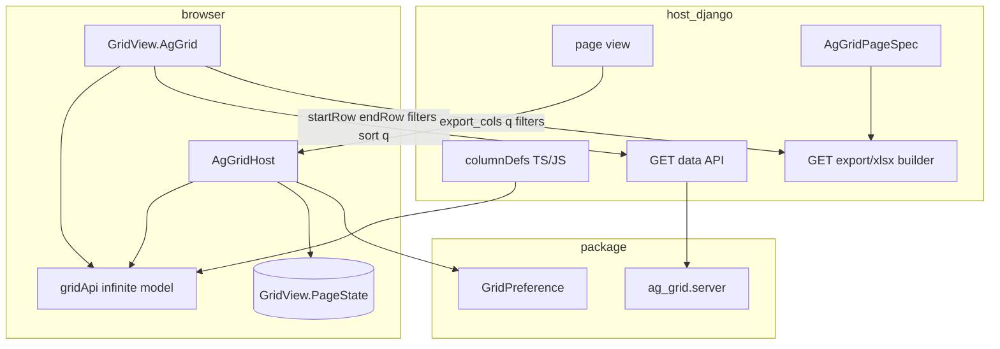
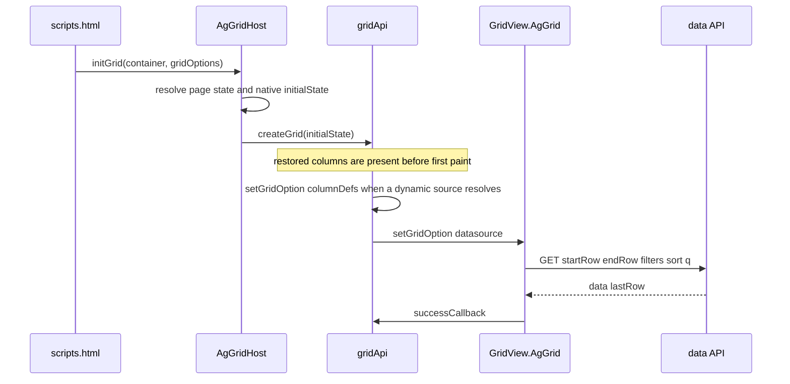

# AG-Grid integration

Extension layer for [AG Grid Community](https://www.ag-grid.com/) 31.x in Django: toolbar,
`AgGridHost`, browser-local page state, infinite-model HTTP contract, server XLSX sync.

| Component | Owner |
|-----------|-------|
| `gridApi`, `columnDefs`, cell renderers, filter components | Host |
| JSON data API, ORM field maps, row serialization | Host |
| `AgGridPageSpec`, XLSX column resolution | Host (spec) + package (helpers) |
| `AgGridHost`, toolbar, modal, search bar | Package |
| `GridView.AgGrid`, `grid_view_spec.backends.django.ag_grid` | Package |
| `GridPreference` (named presets, saved searches) | Package model; host mounts save URL |

## CDN pins (`conf.py`)

AG-Grid and SortableJS load from CDN on AG-Grid pages. Versions are **pinned in Django settings**, not hardcoded in templates — host apps can override for self-hosting or semver bumps without forking JS.

| Setting | Default | Purpose |
|---------|---------|---------|
| `GRID_VIEW_SPEC_AG_GRID_VERSION` | `31.3.4` | AG-Grid Community semver (jsDelivr URL built automatically) |
| `GRID_VIEW_SPEC_AG_GRID_CDN_URL` | *(built from version)* | Full script URL override (self-hosted mirror) |
| `GRID_VIEW_SPEC_SORTABLE_VERSION` | `1.15.2` | SortableJS for column-settings drag-reorder |
| `GRID_VIEW_SPEC_SORTABLE_CDN_URL` | *(built from version)* | Full Sortable script URL override |
| `GRID_VIEW_SPEC_ECHARTS_VERSION` | `5.5.1` | ECharts semver (host base template) |
| `GRID_VIEW_SPEC_ECHARTS_CDN_URL` | *(built from version)* | Full ECharts script URL override |

```python
# settings.py — optional overrides
GRID_VIEW_SPEC_AG_GRID_VERSION = "31.3.4"
# GRID_VIEW_SPEC_AG_GRID_CDN_URL = "https://static.myapp.example/vendor/ag-grid-community.min.js"
GRID_VIEW_SPEC_SORTABLE_VERSION = "1.15.2"
GRID_VIEW_SPEC_ECHARTS_VERSION = "5.5.1"
```

Host base template (charts):

```django
<script src="{{ echarts_cdn_url }}"></script>
{# or in view context: from grid_view_spec.backends.django.conf import echarts_cdn_url #}
```

Python helpers: `grid_view_spec.backends.django.conf.ag_grid_cdn_url()`, `sortable_cdn_url()`, `echarts_cdn_url()`.

## Architecture



## Infinite data API contract

### Response

```json
{
  "data": [
    { "id": 1, "sku": "ABC-001", "customer": "Ada" }
  ],
  "lastRow": 45000
}
```

| Field | Type | Rule |
|-------|------|------|
| `data` | `object[]` | One object per row; keys = `columnDefs[].field` / `colId` |
| `lastRow` | `int` | Total row count after server filters (not page size) |

Empty keys may be omitted in sparse rows; export uses `AgGridPageSpec` column order, not `Object.keys(row)`.

### Request query parameters

| Param | Source | Type | Purpose |
|-------|--------|------|---------|
| `startRow` | `createInfiniteDatasource` | int | Block start (0-based) |
| `endRow` | `createInfiniteDatasource` | int | Block end (exclusive) |
| `filters` | AG Grid `filterModel` | JSON object | Server-side column filters |
| `sort` | AG Grid sort model | JSON array | Server-side sort |
| `q` | Search bar (`manager._searchText`) | string | Quick search |
| `cols` | Visible columns | comma-separated | Multi-column search scope |
| `export_cols` | `syncExportHref` only | comma-separated | XLSX column ids (not sent on infinite fetch) |
| `action` | Host | string | e.g. `dictionary` for set-filter values |
| `field` | Host | string | Column id when `action=dictionary` |

Host-specific params (period, tab, …) pass via `getExtraParams` in JS and replay in export builders.

### Filter JSON (`filters` param)

Set filter (custom or AG set):

```json
{ "status": { "values": ["Active", "Pending"] } }
```

Text filter:

```json
{ "sku": { "filterType": "text", "type": "contains", "filter": "abc" } }
```

Supported text `type` values in `apply_grid_filters`: `contains`, `notContains`, `equals`, `notEqual`, `startsWith`, `endsWith`.

Pass `format_filter_value(col_id, display_value)` when DB values differ from filter labels.

### Sort JSON (`sort` param)

```json
[{ "colId": "registered_esoz", "sort": "desc" }]
```

Only the first entry is applied; host supplies `field_map: colId → ORM path`.

### Dictionary action

```
GET /api/products/?action=dictionary&field=record_match_status
→ { "values": ["…", "…"] }
```

Wire `dictionaryUrl` in `gridOptions.context`.

### Faceted set filter (package dictionary endpoint)

For counts that stay in sync with every other filter and search (exclude-own), use the
package-provided `api_column_filter_dictionary` route plus a registered `FacetSource`:

```
GET /grid/filter-dictionary/?grid=<grid_id>&field=<col_id>&<current params>
→ { "values": [{"value": "Adult", "count": 42}, …] }
```

```javascript
gridOptions.context = {
  gridId: "doctors",
  dictionaryUrl: "/grid/filter-dictionary/",
  // …
};
```

Register a `FacetSource` per grid at startup so the endpoint can resolve the filtered
source and count distinct values — see [Faceted filtering](../filtering/facets.md) for the
full callback contract and an NSZU example. Mount the route via
`include("grid_view_spec.backends.django.urls")` — [Django integration](../integration/django.md).

### Python: `InfiniteGridParams`

```python
from grid_view_spec.backends.django.ag_grid import (
    apply_grid_filters,
    apply_grid_sort,
    parse_infinite_params,
)

params = parse_infinite_params(request)  # default_page_size=100
# params.start_row, params.end_row, params.search_query
# params.visible_cols, params.filters, params.sort_model
# params.action, params.action_field
```

## AgGridPageSpec contract

```python
from grid_view_spec.types.ag_grid import AgGridColumnSpec, AgGridPageSpec

PRODUCTS_PAGE_SPEC = AgGridPageSpec(
    grid_id="products",
    columns=(
        AgGridColumnSpec("sku", "SKU"),
        AgGridColumnSpec("name", "Name"),
        AgGridColumnSpec("cost", "Cost", hide=True),
    ),
)
```

| `AgGridColumnSpec` field | Default | Meaning |
|--------------------------|---------|---------|
| `col_id` | — | AG Grid `colId` / row key |
| `label` | — | XLSX header, UI labels |
| `hide` | `False` | Default visibility when no live grid snapshot |
| `exportable` | `True` | Included in export resolution |

| `resolve_export_columns(spec, request)` input | Result |
|-----------------------------------------------|--------|
| `export_cols=a,b,c` (subset of exportable ids) | Those ids in request order |
| `export_cols` absent or empty | All columns with `exportable=True` and `hide=False` |

Constant: `EXPORT_COLS_PARAM = "export_cols"`.

## JavaScript contract

Load assets once per page (base template, outside HTMX swaps):

```django



```

AG Grid Community + SortableJS from CDN in the same base template.

### Boot sequence



```javascript
// This is a later dynamic-column update, after createGrid has made manager.gridApi.
// PageState is resolved before grid creation and is not reapplied here.
manager.gridApi.setGridOption("columnDefs", ProductColumns);
manager.gridApi.setGridOption(
  "datasource",
  GridView.AgGrid.createInfiniteDatasource({
    url: "/api/products-data/",
    manager: manager,
    getExtraParams: () => ({ period: "2025-01" }),
    onLastRow: (count) => { /* toolbar counter */ },
  })
);
```

### `gridOptions.context`

| Key | Default | Contract |
|-----|---------|----------|
| `gridId` | — | Equals `grid_id` in `scripts.html` and `GridPreference.grid_id` |
| `syncUrlState` | `true` | `history.replaceState` for `q`, `filters`, `urlPageStateKeys` |
| `urlPageStateKeys` | keys from `getPageState()` | Domain params mirrored to URL |
| `getPageState()` | — | Returns `{ period: ["2024-01"], … }` for filter bar |
| `applyPageState(state, opts)` | — | Restores domain filter bar |
| `onFilterChanged(manager)` | — | Hook after AG filter change (export sync) |
| `onDataReload(manager)` | — | Hook after manual search reload; otherwise export links are synced automatically |
| `dictionaryUrl` | — | Base URL for set-filter dictionary fetch |

The rendered spec identity and optional `GridViewConfig.page_state_scope` select
browser page state. GridViewSpec does not read renderer-specific browser keys.

### Export href sync

```javascript
GridView.AgGrid.syncExportHref(linkEl, manager, {
  getExtraParams: () => ({ period: "2025-01" }),
  exportColumns: true,  // writes export_cols (default true)
});
```

`syncExportHref` accepts either a runtime handle or a grid id string. `syncExportLinks`
updates every `[data-cm-export-sync][data-cm-grid-id="…"]` link for the grid.

```javascript
GridView.AgGrid.syncExportHref(linkEl, "products", {
  getExtraParams: () => ({ period: "2025-01" }),
});
GridView.AgGrid.syncExportLinks("products");
```

Call on first load and on filter/column/search changes; invoke again in link `onclick` before navigation.

| `syncExportHref` option | Default | Effect |
|-------------------------|---------|--------|
| `exportColumns` | `true` | Visible column ids → `export_cols` |
| `includeVisibleCols` | `false` | Also set `cols` on export URL |

## Page wiring

### Template (GridViewSpec v2)

```django



```

For hand-wired AG-Grid pages (without full spec render), load assets in base layout:

```django

{# … page body with #products-grid … #}


```

Column settings and export hrefs use `` with toolbar blocks.

### Host view

```python
import json
from grid_view_spec.backends.django.models import GridPreference

def products_view(request):
    presets, searches = {}, []
    if request.user.is_authenticated:
        pref = GridPreference.objects.filter(user=request.user, grid_id="products").first()
        if pref:
            presets, searches = pref.col_presets, pref.searches
    return render(request, "products.html", {
        "ag_grid_presets": json.dumps(presets),
        "ag_grid_searches": json.dumps(searches),
    })
```

### Save preferences URL (host-mounted)

Package ships `save_grid_settings` view; host registers it with name **`api_grid_preferences`**:

```python
from grid_view_spec.backends.django.views import save_grid_settings

urlpatterns = [
    path("api/grid/preferences/", save_grid_settings, name="api_grid_preferences"),
]
```

### XLSX link

```django
<a href=""
   id="products-xlsx"
   onclick="syncProductsExport();">XLSX</a>
```

```python
register_xlsx_export("products_page", build_products_xlsx_job, filename_fn=…)
```

## Persistence

Column settings UI lives in `grid-view.min.js` (`GridView.createColumnSettings`).
`AgGridHost` binds it after `gridApi` initialization; Simple Table uses the DOM
adapter. See [Column settings](settings.md).

AG Grid uses two persistence mechanisms:

| Mechanism | Identity | Contents |
|-----------|----------|----------|
| Browser-local `GridView.PageState` | `spec.id` + optional scope + namespace | `grid.<block-id>.columns` and `grid.<block-id>.ag_grid` snapshots |
| Named `GridPreference` | Authenticated user + `grid_id` | User-named column presets and saved search bookmarks |

The URL is not a persistence mechanism. It carries shareable request state. URL
`q`, filters, and host URL values override browser-local fallback values.

`GridView.PageState` stores shared column layout in `grid.<block-id>.columns` and
AG-Grid-specific state in `grid.<block-id>.ag_grid`. It keeps the last browser-local
layout without writing it to Django. Named presets and searches use
`POST api_grid_preferences` when the host provides that endpoint.

### Restore precedence

| State | Source order |
|-------|--------------|
| Quick search | URL `?q=` → browser-local page state |
| AG filters | URL `?filters=` → browser-local page state |
| Host URL state | Host URL value → host page-state namespace |

See [Page state](../persistence/page-state.md) for namespaces and compatibility.
See [Saved preferences](../persistence/preferences.md) for the named-preference API.

## Integration checklist

| # | Requirement |
|---|-------------|
| 1 | AG Grid + Sortable CDN in base template |
| 2 | `` once per page |
| 3 | `grid_id` = `context.gridId` = `GridPreference.grid_id` |
| 4 | `ag_grid_presets`, `ag_grid_searches` in view context |
| 5 | `api_grid_preferences` → `save_grid_settings`; `migrate grid_view_spec_django` |
| 6 | Data API: `{ data, lastRow }` + `parse_infinite_params` |
| 7 | XLSX: `AgGridPageSpec` + `resolve_export_columns` + `syncExportHref` |
| 8 | Late `columnDefs`: `reapplyPersistedState()` before datasource |

## Runtime constraints

| Rule | Detail |
|------|--------|
| HTMX | AG Grid CDN and bundle load outside swapped fragments |
| Search | Infinite model uses server `q`; not `quickFilterText` |
| Export | Server XLSX via registered builder — [XLSX export](../export/xlsx.md) |
| License | AG Grid Community 31.x APIs only |

## Filtered KPI strip

```django

```

```javascript
GridView.bindGridKpis({ gridAdapter: GridView.createAgGridAdapter(gridApi) });
```

See [KPI and charts](../visualization/kpi-charts.md).

## Reference: host integration

| Layer | Module |
|-------|--------|
| Spec | `dashboard/items/ag_grid/spec.py` |
| API | `ag_grid/api.py`, `queryset.py`, `fields.py`, `serializers.py` |
| XLSX | `export.py` — builder key `items_grid` |
| Columns | your frontend `columnDefs` |
| Templates | `_grid_options.html`, `_grid_scripts.html`, `_toolbar.html` |

Typical config: `grid_id="items"`, data endpoint `GET /api/items/data/`.

## API reference

- [Python types](../reference/python-types.md)
- [JavaScript API](../reference/javascript.md)
- [Template tags](../reference/template-tags.md)
- [Saved preferences](../persistence/preferences.md)
